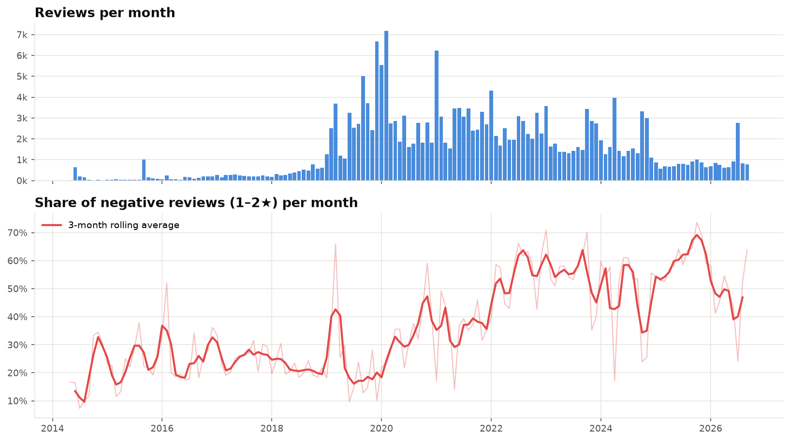
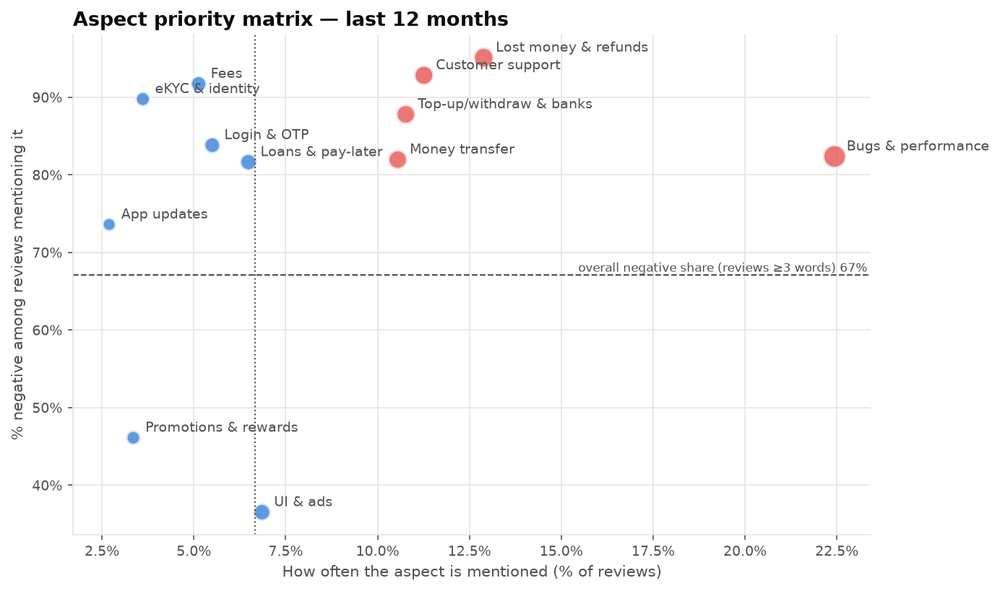
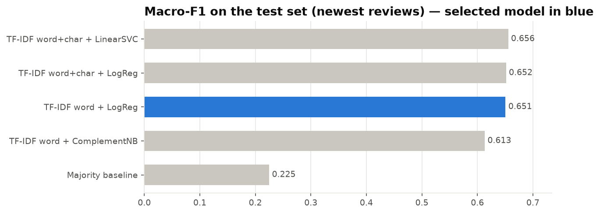

# 💬 MoMo Play Store Reviews — Customer Experience Analytics & Vietnamese Sentiment Modelling

   

An end-to-end project on **217,357 public Google Play reviews** of MoMo, Vietnam's largest e-wallet (May 2014 → Oct 2026):
**data collection → Vietnamese text cleaning → business analytics (DA) → sentiment classification (ML) → topic modelling & aspect analysis (NLP) → demo app**.

**Highlights**
- 📉 The share of negative reviews rose from **22% (2019) to 61% (2025)**.
- 🔎 The most frequent complaints are about **bugs & performance**. **Lost money & refunds** is the most negative aspect: **95%** of the reviews that mention it are negative.
- 🤖 Sentiment model evaluated on a **time-based split**: macro-F1 **0.65** on 3 classes, and **F1 0.94 / ROC-AUC 0.975** for complaint detection.
- 🧹 Found **226 spam reviews** advertising loan apps; **62%** of them gave 5★ and inflate the rating.

---

## 1. Problem

MoMo receives hundreds of reviews every day. Reading them all by hand is not feasible, and the **average star rating** hides the questions that matter: *what are users unhappy about, since when, and in which app version?*

| Question | Lens | Notebook |
|---|---|---|
| How does satisfaction evolve over time and across versions? How does MoMo respond? | Data Analyst | [`01_eda_business_insights`](notebooks/01_eda_business_insights.ipynb) |
| Can we detect negative feedback from the *text alone* (e.g. channels without star ratings)? | Data Scientist / ML | [`02_sentiment_model`](notebooks/02_sentiment_model.ipynb) |
| What do users complain about, and what should be fixed first? | NLP + DA | [`03_topics_and_aspects`](notebooks/03_topics_and_aspects.ipynb) |

## 2. Key results

### 📉 The experience deteriorated sharply after 2021


| Year | Reviews | Avg rating | % negative (1–2★) |
|---|---:|---:|---:|
| 2019 | 36,043 | 4.00 | 22% |
| 2021 | 36,880 | 3.58 | 33% |
| 2023 | 24,568 | 2.69 | **56%** |
| 2025 | 9,229 | 2.47 | **61%** |
| 2026 (to Oct) | 9,437 | 3.21 | 43% |

- Ratings are **strongly polarised** (mostly 5★ and 1★). The negative share is therefore a more sensitive KPI than the average rating.
- Notebook 01 includes an **anomaly alert** (each month's negative share as a z-score against the previous 12 months) and the negative share **by app version**, to trace incidents back to specific releases.

### 🔎 What do users complain about? (last 12 months)


| Aspect | % of reviews mentioning it | % of those that are negative |
|---|---:|---:|
| Bugs & performance (lag, freezes, crashes) | 22.4% | 82% |
| Lost money & refunds | 12.9% | **95%** |
| Customer support | 11.3% | 93% |
| Top-up / withdrawal & bank linking | 10.8% | 88% |
| Money transfer | 10.5% | 82% |

→ **Priority** goes to the red corner: aspects that are both frequent *and* highly negative. *Customer support* (+4.0 pp) and *eKYC/identity verification* (+3.4 pp) are the **fastest-growing** complaints over the last two quarters, while *bugs & performance* fell by 8.5 pp.

### 🤖 Sentiment classifier


| Model (test = newest 43k reviews, Dec 2023 → Oct 2026) | Macro-F1 | F1 neg | F1 pos | Train time |
|---|---:|---:|---:|---:|
| Majority baseline | 0.225 | – | 0.675 | – |
| TF-IDF + Complement Naive Bayes | 0.613 | 0.897 | 0.914 | 9 s |
| **TF-IDF word + Logistic Regression** ✅ | **0.651** | 0.887 | 0.922 | 81 s |
| TF-IDF word+char + Logistic Regression | 0.652 | 0.888 | 0.922 | 156 s |
| TF-IDF word+char + LinearSVC | 0.656 | 0.908 | 0.930 | 552 s |

- **Binary task, "is this review a complaint?":** F1 = **0.937**, ROC-AUC = **0.975**.
- The *neutral* class (3★, only ~3% of the data) is the hardest (F1 0.14). 3★ reviews usually mix praise and criticism, and the star labels themselves are inconsistent.
- **Why Logistic Regression and not LinearSVC?** LinearSVC scores 0.005 higher, which is within noise. Logistic Regression trains **~7× faster**, so regular retraining is cheaper, and it outputs **probabilities** that can drive alert thresholds.
- **Error analysis:** 1,051 test reviews (2.4%) are rated 4–5★ but the text is a complaint, e.g. *"3 tiếng đồng hồ rồi tôi không vào được ứng dụng"* ("I haven't been able to open the app for 3 hours"), rated 5★. Looking only at stars misses them, which is where a text model adds business value for customer support.

### 🧹 Other findings
- **Loan-spam campaigns inside reviews:** 226 reviews from spam campaigns that obfuscate domains (`VAY9 . C0M`, `( W E B )`, the "TinChac" app…). **62% of them are 5★**, which inflates the rating. They are excluded from training.
- **The reply policy changed completely:** between 2017 and 2023 MoMo answered very few reviews (under 5% in most years, peaking at 21% in 2020). Since 2025 it answers ~90–95% of reviews with a median reply time **under 30 minutes**, most likely automated.
- Negative reviews are far longer than positive ones (median 13 vs. 2 words), which makes them rich input for topic analysis.

## 3. Approach

```
Google Play ─crawl.py─▶ raw.parquet ─preprocess.py─▶ clean.parquet ─┬─▶ 01 EDA & KPIs
 (217k reviews,         (no names or      (text normalisation, spam   ├─▶ 02 Sentiment ─▶ model.joblib ─▶ Streamlit app
  checkpoint + retry)    avatars stored)   flags, labels, versions)   └─▶ 03 NMF topics ─▶ aspects.py ─▶ priority matrix
```

| Step | Technical notes |
|---|---|
| **Crawling** ([`crawl.py`](src/momo_reviews/crawl.py)) | Continuation-token pagination with retry and exponential backoff. Checkpoints go to a `.partial` file that replaces the dataset only after a complete run. **No personal data** (names, avatars) is stored. |
| **Vietnamese normalisation** ([`text.py`](src/momo_reviews/text.py)) | Unicode NFC, ~80 teencode/abbreviation rules (`ko`→`không` "not", `dc`→`được` "can"), emoji → sentiment tokens, character de-elongation (`tốtttt`→`tốt`), masking of phone numbers and URLs, regex spam detection. |
| **Labelling** | Weak supervision from star ratings: 1–2★ negative, 3★ neutral, 4–5★ positive. |
| **Evaluation** ([`model.py`](src/momo_reviews/model.py)) | **Time-based split** (train on the past, test on the newest 20%) instead of a random split. This mirrors deployment, avoids leakage from the future, and lets us track **drift** per quarter. Macro-F1 because the classes are imbalanced. |
| **Features** | TF-IDF on syllable bigrams (≈ Vietnamese compound words, no word segmenter needed) plus char 2–5-grams (robust to typos and missing diacritics). |
| **Topics → aspects** ([`aspects.py`](src/momo_reviews/aspects.py)) | NMF to *discover* complaint topics, then frozen into keyword lists to *measure* them consistently over time and explain them easily to product teams. |

## 4. Run it

```bash
git clone https://github.com/catcatmeomeo/Momo_Playstore_User_Feedback.git
cd Momo_Playstore_User_Feedback
python3 -m venv .venv && source .venv/bin/activate
make install
```

```bash
make app        # demo app with the pre-trained model (http://localhost:8501)
make test       # unit tests
make all        # re-crawl everything (~30 min) -> retrain -> re-execute the 3 notebooks
```

The full dataset is not committed; rebuild it with `make data`. A 3,000-review sample is included at [`data/sample/`](data/sample/momo_reviews_sample.csv) for the app's batch (CSV) tab.

## 5. Repository structure

```
├── src/momo_reviews/           # package: crawl, preprocess, text, model, aspects, viz, config
├── notebooks/                  # 01 EDA · 02 model · 03 topics (executed, outputs included)
├── scripts/build_notebooks.py  # notebooks generated from code -> clean diffs in review
├── app/streamlit_app.py        # demo: score one review or a whole CSV
├── models/                     # trained model (~3 MB)
├── reports/                    # figures/, model_comparison.csv, metrics.json
├── data/sample/                # small data sample
├── archive/                    # v1 notebook (original version of this project)
├── tests/                      # pytest, run in GitHub Actions
└── Makefile                    # make data | model | notebooks | app | test | all
```

## 6. Project evolution (v1 → v2)

This project started as a single exploratory notebook ([`archive/v1_Analyze_Insight_Momo_wallet.ipynb`](archive/v1_Analyze_Insight_Momo_wallet.ipynb)). v1 crawled the reviews, computed descriptive statistics and charts, and set out to predict sentiment. v2 turns that idea into a reproducible pipeline:

| | v1 | v2 |
|---|---|---|
| Data | Excel files shared via OneDrive | Reproducible crawl (`make data`), parquet, no personal data |
| Cleaning | Dropped every review missing `appVersion` (−23% of data) | Keeps them for text analysis; normalises Vietnamese text; filters spam |
| Modelling | Goal stated, no model | 5 models compared on a time-based split, plus error analysis and a drift check |
| Insights | Descriptive charts | KPIs, anomaly alerts, aspect priority matrix, recommendations |
| Engineering | One notebook | Python package, tests, CI, Makefile, demo app |

v2 was built with the help of an AI coding assistant (Claude). Every result was re-run and checked against the data, and the analysis decisions are documented in the notebooks.

## 7. Lessons learned
- **Choose metrics that match the data.** With polarised ratings, the average rating hid a near three-fold rise in the negative share (22% → 61%). With imbalanced classes, accuracy would have hidden a weak neutral class.
- **Split by time, not at random,** when the model will be used on future data. That is the only honest estimate of production performance.
- **Many model "errors" are label noise.** Reading misclassified reviews revealed 5★ complaints, and that turned into a business use case.
- **Look at the raw data.** Spam campaigns, an abbreviation rule that silently broke the "loans" aspect (`vay` "borrow" was being rewritten to `vậy` "so"), and an interrupted crawl that overwrote the dataset were all found by inspecting the data, not the metrics.

## 8. Limitations & next steps
- Store reviews are a **self-selected sample** (very happy and very unhappy users write more) and do not represent all users.
- Star-based labels are noisy. Hand-labelling ~1–2k reviews would give a clean test set.
- Fine-tune **PhoBERT** (needs a GPU), mainly to improve the neutral class. Move to **aspect-based sentiment** instead of one label per review.
- Automate: weekly crawl plus an alert when a release's negative share crosses a threshold.

## Author
**Tam Nguyen**: aspiring Data Analyst / Data Scientist · GitHub [@catcatmeomeo](https://github.com/catcatmeomeo)

---
*Data consists of public Google Play reviews and is used for educational and research purposes only. No user-identifying information is stored.*
